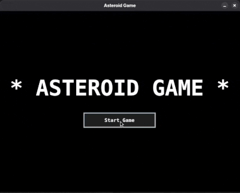

# **ASTEROID GAME**



This project is a game built in java using swing class.
Imagine the best game you have ever played. This is that game.

This was the game that made GTA VI graphics team cry.

(this was most definitely not a Java Project for my **OOP Programming with Java** class that i repurposed and pushed to github)

## Requirements 
- Java Development Kit (JDK) 21 or later (for developing and running)
- Java Runtime Environment (JrE) 21 or later (for only running)

## To compile
```shell
javac -sourcepath src Main.java
```

## To run 
```shell
java Main
```
## Game Controls
- right / A -> to move right
- left / D -> to move left
- space / up / W -> to shoot

## File Structure
```
AsteroidGame                                
+-- src                                     
|   +-- game                                
|   |   +-- Asteroid.java //Asteroid Object
|   |   +-- GameObject.java //Parent Class  
|   |   |         to all game objects         
|   |   +-- Ship.java //Player Ship object  
|   |   +-- ShipBullet.java // bullet object
|   +-- ui                                  
|       +-- GameDeath // Death Screen       
|       +-- GameMenu //Menu Screen          
|       +-- GamePanel //Game Screem         
|       +-- GameWindow //Game Window        
+-- util                                    
|   +-- AsteroidSpawner.java                
|   +-- Constants.java                      
+-- Main.java // main method
```